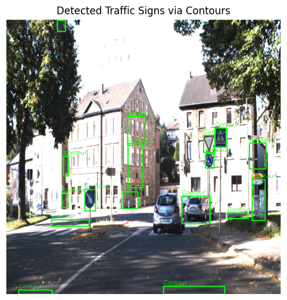
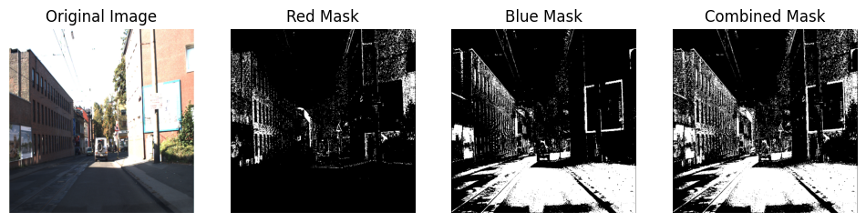
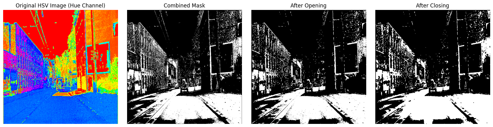
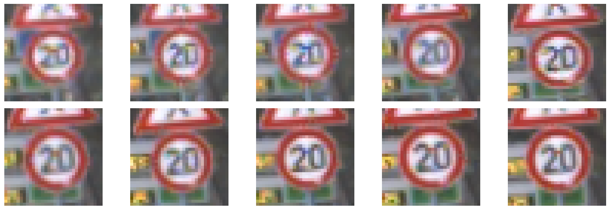
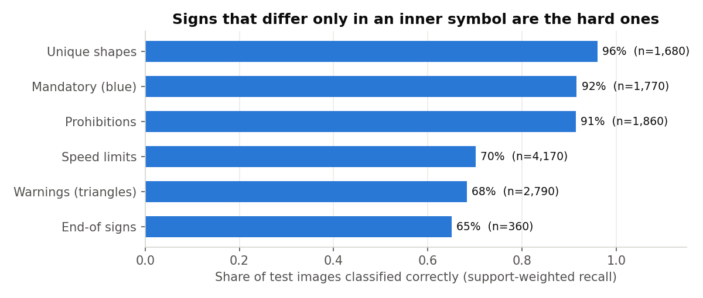
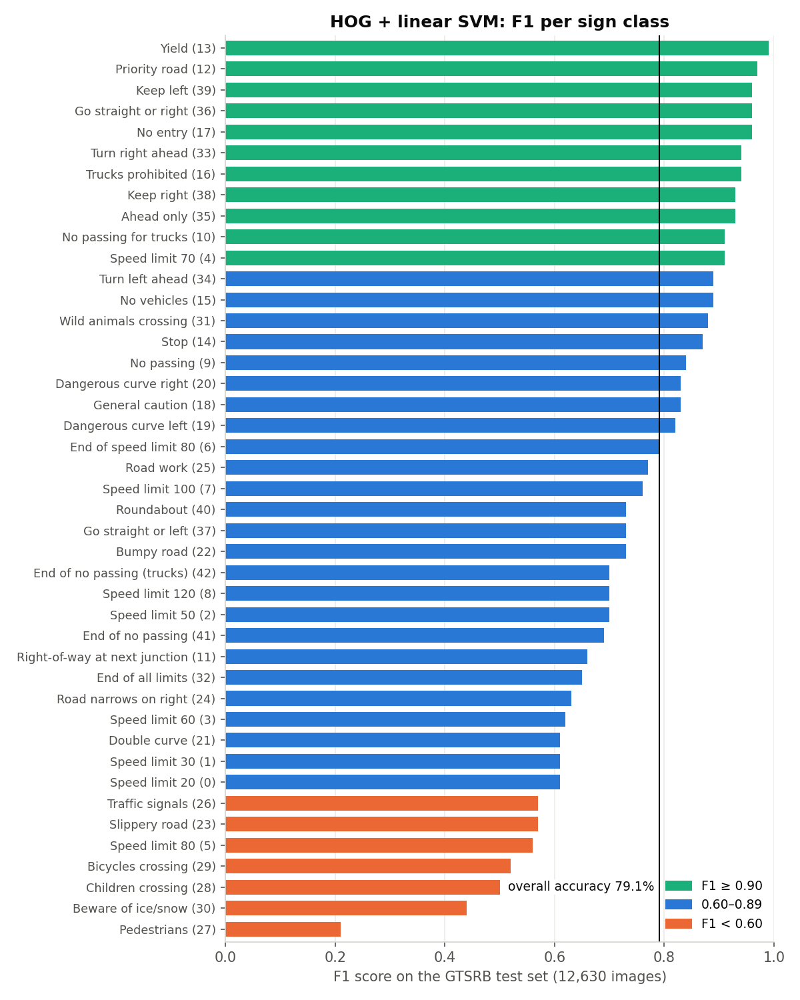

# Traffic Sign Detection & Recognition

A classical computer-vision pipeline that **finds** traffic signs in road scenes with colour segmentation and
morphology, then **recognises** them with HOG features and a linear SVM. It reaches **79.2% accuracy over 43 sign
classes** on the 12,630-image GTSRB test set, with no deep learning and no GPU.

<p align="center"></p>

## Pipeline

```
road scene (1360×800)
   │ resize 720×720 → HSV → equalise brightness (V channel)
   ▼
colour masks: red (two hue ranges, red wraps at 0/180) + blue
   │ morphological opening (remove speckle) → closing (fill holes)
   ▼
contours → candidate regions (area & size filters)
   │ crop → 32×32 grayscale
   ▼
HOG descriptor (324-d) → linear SVM → one of 43 sign classes
```

| Stage | What it looks like |
|---|---|
| Colour segmentation |  |
| Morphological clean-up |  |
| Classifier input (GTSRB, 32×32) |  |

## Data

| Dataset | Used for | Size |
|---|---|---|
| [GTSDB / IJCNN 2013](https://benchmark.ini.rub.de/gtsdb_dataset.html) | Detection: full road scenes with sign boxes | 600 scenes |
| [GTSRB](https://benchmark.ini.rub.de/gtsrb_dataset.html) | Recognition: cropped signs, 43 classes | 39,209 train / 12,630 test |

On the 600 scenes, segmentation proposed **6,093** candidate regions. The size filter kept **4,462** of them.

## Results

| Metric | Value |
|---|---|
| Test accuracy (12,630 images, 43 classes) | **79.2%** |
| Macro-average F1 | 0.75 |
| Training accuracy | 91.5% |

<p align="center"></p>

**What the errors say.** Signs with a distinctive **shape or colour** (Yield, Stop, Priority road, the blue mandatory
signs) are recognised 91–96% of the time. Signs that share an outline and differ only in a **small inner symbol**
are the problem: speed limits (20 vs 30 vs 80) at 70%, and red-triangle warnings at 68%. "Pedestrians" has an F1 of
just 0.21. At 32×32 pixels, HOG captures the outline well but blurs the digits and pictograms. That points to the next
step: a small CNN, or HOG at a higher resolution plus colour histograms, aimed at those two families.

<details>
<summary>F1 for all 43 classes</summary>
<p align="center"></p>
</details>

## Business impact

**Use case: road-asset inventory for a municipality or a mapping company.** Signs are surveyed by people, either
driving and logging them or watching dash-cam footage frame by frame. The pipeline turns this into *review the
flagged frames*.

An illustrative estimate, using assumptions you can swap for real figures:

| Assumption | Value |
|---|---|
| Road network to audit | 1,000 km |
| Manual video review | 1 hour per 10 km → **100 hours** |
| With the pipeline: review only frames with a detected sign, confirm or correct the label | ~25 hours |

**Saving ≈ 75 review hours per 1,000 km** (formula: `manual_hours × (1 − share_of_footage_still_reviewed)`).

How the numbers above translate into deployment choices:

- **Auto-accept only the strong families.** Unique-shape and mandatory signs (92–96%) can be logged automatically;
  speed limits and warnings (68–70%) should always go to a person. Routing by class like this turns a 79% model into
  a system that is useful today.
- **Runs on a CPU.** HOG + a linear SVM classifies a crop in well under a millisecond, so it fits on in-vehicle hardware
  or cheap cloud instances. No GPU budget is needed.
- **Before production:** the detector stage needs a proper evaluation. Precision and recall of the region proposals
  against the ground-truth boxes have not been measured yet (see below).

## Limitations

- **End-to-end detection was not evaluated.** The IoU and detection-accuracy helpers (notebook section 9) were
  written but never run. `compute_iou` also mixes `(x, y, w, h)` and `(x1, y1, x2, y2)` box formats, so it needs
  fixing first. The 79.2% figure is **classification on pre-cropped GTSRB signs**, not detection in full scenes.
- **The colour masks are noisy.** The blue range also matches sky, shadows and road surface (see the
  segmentation figure), which is why 6,093 candidates were proposed for 600 scenes. Shape checks (circle, triangle,
  octagon) or a learned detector would cut the false positives sharply.
- **Some overfitting:** 91.5% on training data vs 79.2% on test data.
- Only 3 figures per step are kept in the notebook (the original was 40 MB). The full outputs come back when it is re-run.

## Reproduce

1. Download **GTSRB** (`Final_Training/Images`, `Final_Test/Images`, `GT-final_test.csv`) and **IJCNN 2013 / GTSDB**
   (`TrainIJCNN2013/` with `gt.txt`) from the links above, into the repo root.
2. Run:

```bash
pip install -r requirements.txt
jupyter notebook traffic_sign_detection.ipynb
python scripts/make_charts.py      # redraws docs/*.png from docs/results.json
```

## Author

**Jana Emad**

## License

MIT
